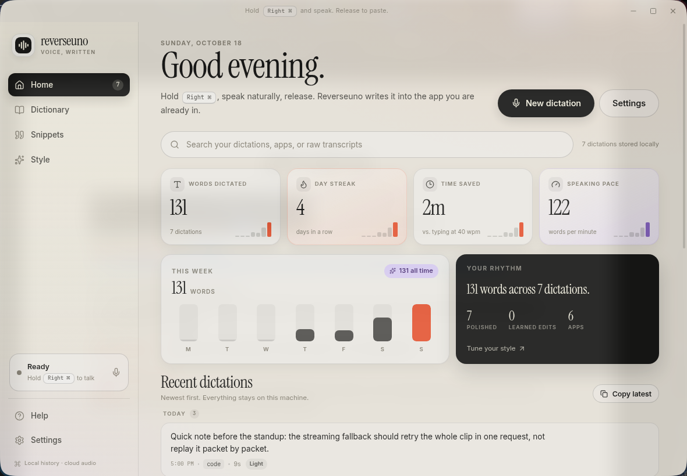
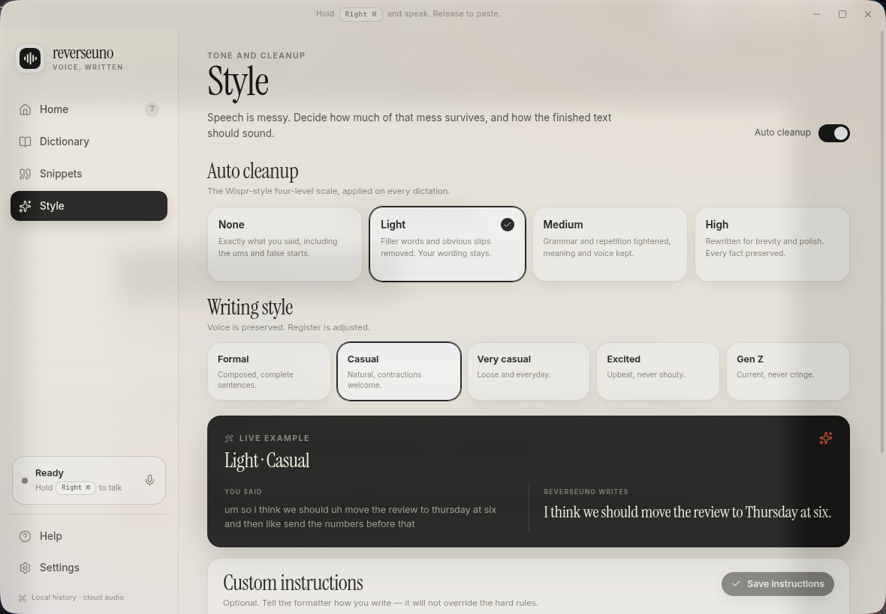
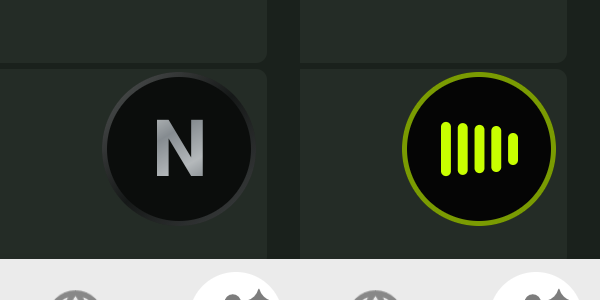
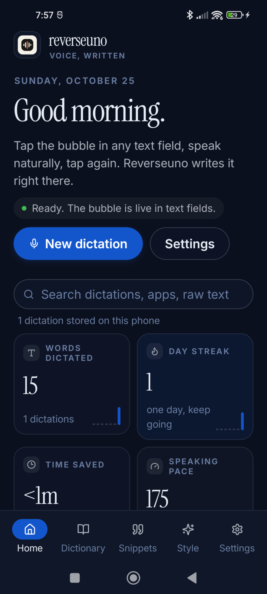
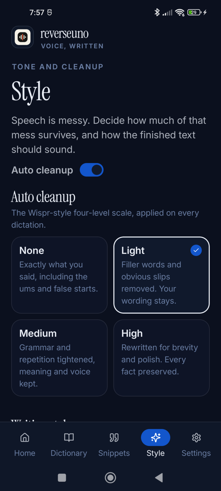

<div align="center">
  
  <h1>reverseuno</h1>
  <p><strong>Push-to-talk dictation for Omarchy / Hyprland.</strong></p>
  <p>Hold Right Super → speak → release. The polished text lands at your cursor.</p>

  <p>
    
    
    
    
    
    
    
  </p>
</div>

<table>
  <tr>
    <td width="62%" align="center"></td>
    <td width="38%" align="center"><br><br></td>
  </tr>
</table>

Linux only: an Electron app shaped around Omarchy, Hyprland and an Apple Magic
Keyboard (Right Cmd is `Super_R`). Cloud speech-to-text, cloud formatting, everything
else local.

There is also a native Android version with a floating bubble above the keyboard: see
[Android](#android).

## The journey

One loop:

```text
Hold Right Super
  → speak
  → release
  → transcribe (Deepgram Nova-3 streaming, or an OpenRouter model)
  → polish (OpenRouter or Anthropic) + dictionary spellings
  → paste into the window you started in
```

| Stage | What happens |
|---|---|
| **Hold** | The overlay appears with a live waveform. The focused window is remembered. |
| **Speak** | 16 kHz mono audio streams to Deepgram; interim words show in the overlay. |
| **Release** | Transcribing, then polishing with your cleanup level, style and dictionary. |
| **Paste** | Focus returns to the original window if it moved, then `Ctrl+V` or `Shift+Insert` per app. Your clipboard is restored. |
| **Done** | A short “Pasted”, then the overlay hides. |

The overlay never takes focus and ignores the mouse while recording, so it cannot
steal the paste. `Super+Delete` cancels. If the original window is gone, the text is
left on your clipboard instead of landing somewhere else.

## What’s on screen

| Surface | Role |
|---|---|
| **Overlay** | 500×108 dark pill: waveform, “Listening”, the target app, interim text, timer, key hints. Optional resting pill. |
| **Home** | Stats, weekly chart, rhythm, edit-to-learn suggestions, searchable history grouped by day. |
| **Dictionary** | Words and spoken-form corrections. Entries keep their exact spelling, so `fastfetch` stays lowercase. **Add developer words** loads ~170 terms. |
| **Snippets** | Say a trigger, get the full text. |
| **Style** | Four cleanup levels, five writing styles, custom instructions, app context. |
| **Settings** | Key, language, microphone, providers and models, insertion rules, appearance, overlay, history. |
| **Tray** | Start/stop, open the hub, quit. |

The hub follows the active **Omarchy theme**, light or dark, and switches live with
it. Settings → Appearance → **Paper** restores the built-in look.

<table>
  <tr>
    <td width="50%" align="center"></td>
    <td width="50%" align="center"></td>
  </tr>
</table>

## Engines / models

BYOK. No keys ship with the app.

| Engine | Role | Network |
|---|---|---|
| **Deepgram Nova-3** | Default speech-to-text. WebSocket streaming with interim results, dictionary keyterms, whole-clip batch fallback. | Audio to Deepgram while you speak |
| **OpenRouter STT** | Alternative speech-to-text: any model from OpenRouter's transcription catalogue (default `openai/gpt-4o-mini-transcribe`). No live preview. | Audio to OpenRouter on release |
| **OpenRouter formatter** | Default cleanup and style. Hard timeout; falls back to the raw transcript. | Transcript text to OpenRouter |
| **Anthropic formatter** | Alternative cleanup and style, straight to the Claude API (default `claude-haiku-5-5`, low effort). Same timeout and fallback. | Transcript text to Anthropic |

Pick the speech provider, the text-formatting provider and models in Settings →
Providers; the OpenRouter model fields suggest from OpenRouter's live lists. Keys are
read from Settings, then `DEEPGRAM_API_KEY` / `OPENROUTER_API_KEY` /
`ANTHROPIC_API_KEY`, then `~/.config/whisper-bar/config.env`.

For accented English, set Language to **English** rather than Multilingual: the
recogniser then never guesses another language.

## Stack

| Layer | Technology |
|---|---|
| Shell | Electron 44, electron-vite |
| UI | React 19, plain CSS with theme tokens |
| Audio | `getUserMedia` + `AudioWorklet`, 640-sample (40 ms) frames |
| Speech-to-text | Deepgram WebSocket / REST, OpenRouter `/audio/transcriptions` |
| Formatting | OpenRouter chat completions, or the Anthropic Messages API (`@anthropic-ai/sdk`) |
| Insertion | `wl-copy` / `wl-paste`, `wtype`, `hyprctl` refocus |
| Hotkeys | Hyprland binds → `reverseuno` CLI → local HTTP control server |
| Storage | JSON in `~/.config/reverseuno/`; keys via `safeStorage` |

## Install

Requires Arch / Omarchy with Hyprland, Node 22+, `wtype`, `wl-clipboard` and `jq`.

```bash
git clone https://github.com/nodaysidle/reverseuno.git
cd reverseuno
npm install
npm run build
bash scripts/install-local.sh
```

`install-local.sh`:

- symlinks `bin/reverseuno` to `~/.local/bin/reverseuno`;
- writes `~/.local/share/applications/reverseuno.desktop` and adds **Apps → reverseuno**
  to the Omarchy menu;
- backs up `~/.config/hypr/bindings.lua` and writes a managed block (rerunning updates
  it in place):

```lua
o.bind("Super_R", "reverseuno hold", "~/.local/bin/reverseuno start")
o.bind("Super_R", "reverseuno release", "~/.local/bin/reverseuno stop", { release = true })
o.bind("SUPER + Super_R", "reverseuno release (super held)", "~/.local/bin/reverseuno stop", { release = true })
o.bind("SUPER + Delete", "reverseuno cancel", "~/.local/bin/reverseuno cancel")
```

- adds window rules: floating 1180×820 hub, `no_focus` overlay;
- comments out an old WhisperBar `Super_R` bind and reloads Hyprland.

The release is bound twice because Hyprland can still count Super as held while
`Super_R` is released; a duplicate stop is ignored. The real file uses absolute paths.

Then add your keys in Settings → Providers, hold **Right Super**, speak, and release.
For development with hot reload: `npm run dev`.

## Android

A native Android app (Kotlin + Jetpack Compose, Android 12+) with the same hub. A
floating bubble appears just above the keyboard in any text field: tap to start, tap to
stop, or hold to talk. The text is inserted where you are typing. The bubble stays out
of password, number and phone fields.

<p>
  
  
  
</p>

**Download:** `reverseuno-android-0.1.0.apk` from the
[android-v0.1.0 release](https://github.com/nodaysidle/reverseuno/releases/tag/android-v0.1.0).
It is a sideload install; the app is not on the Play Store.

1. Optionally verify the download against the `.sha256` file from the same release:
   ```bash
   sha256sum -c reverseuno-android-0.1.0.apk.sha256
   ```
   The expected SHA-256 is
   `ece6e7e97a994002be78b8606fd93e9dbf7a98dea01270819a9d8078b466f424`.
2. Open the APK on the phone. When Android asks, allow installs from unknown sources
   for your browser or file manager.
3. Turn on **reverseuno dictation bubble** in Settings → Accessibility (the Home screen
   links there) and allow the microphone.
4. Add your own keys in reverseuno → Settings → Providers: OpenRouter (required),
   Anthropic (cleanup), DeepSeek (optional fallback). No keys ship with the app.
5. On Xiaomi/MIUI, allow Autostart and set Battery to "No restrictions"
   (Settings → Phone setup).

Audio goes to OpenRouter and text to Anthropic (DeepSeek on fallback). Audio is
recorded to the app's private cache and deleted after transcription; keys are kept in
the Android Keystore-backed vault. Building from source, signing and logs:
[android/README.md](android/README.md).

## Shortcuts

| Action | Default |
|---|---|
| Hold to dictate | `Right Super` (Right Cmd on a Magic Keyboard) |
| Cancel | `Super + Delete` |
| Start / stop from the mouse | Tray, hub button or resting pill (toggles) |

Dictations started from the hub save to history instead of pasting, because the hub
itself has focus.

## CLI

```bash
reverseuno start          # press
reverseuno stop           # release → transcribe → format → paste
reverseuno toggle
reverseuno cancel
reverseuno state
reverseuno show settings
reverseuno paste "text"   # insert text at the focused cursor
reverseuno lang cycle
reverseuno quit
```

The CLI talks to `127.0.0.1:47100` (or the next free port) with a per-run bearer token
in `~/.config/reverseuno/control.json` (mode 0600). Each call is logged to
`~/.config/reverseuno/logs/app.log`.

## Testing

```bash
npm test                              # 60 unit tests
npm run typecheck
npm run test:e2e                      # fake mic → STT → format → target window, with a focus steal
E2E_STT=openrouter npm run test:e2e   # the same run through OpenRouter transcription
```

The E2E harness feeds a known WAV through Chromium's fake microphone, steals focus to
a decoy window mid-dictation, and checks that the text lands in the original window,
the decoy stays empty, the clipboard is restored and history is written. Real-key
push-to-talk with a physical mic is verified by hand.

## Architecture

```text
Right Super (Hyprland bind)
        │
        ▼
reverseuno CLI ──HTTP──▶ Electron main (DictationEngine)
                              │
        ┌─────────────────────┼────────────────────────┐
        ▼                     ▼                        ▼
  capture renderer      Deepgram WS / OpenRouter  formatter (OpenRouter or Anthropic)
  AudioWorklet          interim + final           cleanup + style + dictionary
  16 kHz, 40 ms         batch fallback            timeout + raw fallback
        │
        ▼
  refocus target → clipboard + wtype → restore clipboard
        │
        ▼
  history, dictionary, snippets, stats (JSON)
```

| Path | Responsibility |
|---|---|
| `src/main/dictation.ts` | State machine, streaming, fallback, formatting, insertion, history |
| `src/main/stt/` | Deepgram (WebSocket + batch) and OpenRouter clients |
| `src/main/format.ts` | Formatter prompt and the OpenRouter and Anthropic calls |
| `src/main/paste.ts` | Hyprland window lookup and refocus, clipboard snapshot/restore, `wtype` rules |
| `src/main/theme.ts` | Reads and watches the active Omarchy theme |
| `src/main/index.ts` | Windows, IPC, control server, tray, autostart |
| `src/renderer/` | Hub, overlay and hidden capture renderers |
| `src/shared/` | Types, defaults, text cleanup, developer vocabulary, stats, WAV |
| `scripts/install-hyprland.py` | Idempotent Hyprland bind block and window rules |

## Known gaps

- **Hyprland only.** No X11, GNOME or KDE shortcut or overlay path.
- **Cloud only** by design: no offline Whisper.
- No paste verification (Linux would need AT-SPI). A failed paste is recorded in
  history but not retried.
- No focused-field context; only the app class and window title reach the formatter.
- No packaging (AppImage, AUR), auto-update or signed releases yet. The desktop entry
  points at the checkout.
- `safeStorage` falls back to a plainly marked value on systems without a keyring.

## Privacy

- Audio is streamed to Deepgram (or sent once to OpenRouter on release), held in
  memory for that request only, and never written to disk.
- The transcript goes to the chosen formatter (OpenRouter or Anthropic) when
  formatting is on; app class and window title can be sent as context (turn it off
  in Style).
- History, dictionary, snippets and settings stay in `~/.config/reverseuno/`.

No accounts, no analytics, no telemetry.

## License

MIT. See [`LICENSE`](LICENSE).
