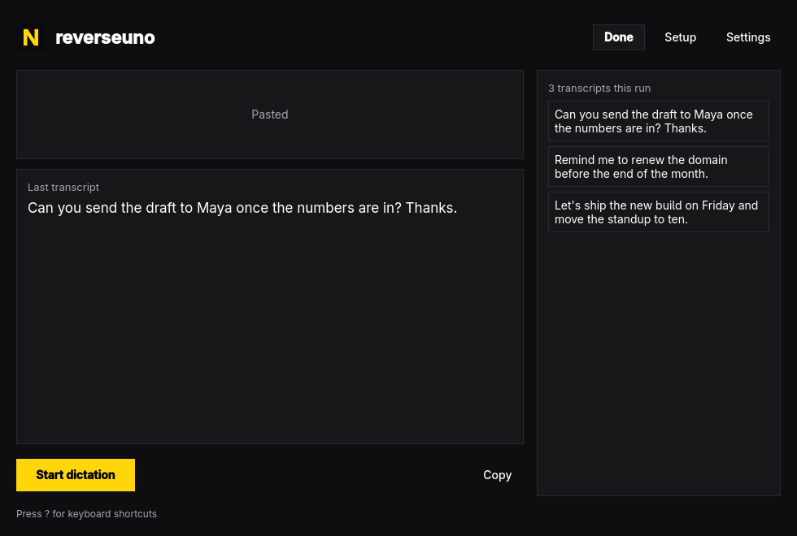

<p align="center"></p>

<p align="center"></p>

# reverseuno

Push-to-talk dictation for [Omarchy](https://omarchy.org) and Hyprland. Hold a key, speak, release,
and the text lands in the window you were typing in.

One small native app: C++ and Qt Quick, one binary, built with `qmake6` and `make`. It follows the
Omarchy theme and language live. Speech goes to Deepgram (`nova-3`); audio lives in memory only and is
never written to disk.

## How it works

1. Hold the key. `reverseuno start` records which window is active, opens the microphone (16 kHz mono)
   and streams the audio to Deepgram over a WebSocket while you speak, so the words appear live.
2. Release. `reverseuno stop` closes the stream and waits up to 2.5 s for the final text. If the stream
   failed or heard nothing, the whole clip, still in memory, is sent in one request instead.
3. The text is pasted into the window you started in: `wl-copy`, then Ctrl+V (Shift+Insert in
   terminals and code editors), then your previous clipboard is put back, but only if it still holds
   what reverseuno wrote. If focus moved it is returned first; if that fails, or the paste fails, the
   text stays on the clipboard and the window says why.

Taps shorter than 250 ms and silent clips produce nothing. One session runs at a time, and a session
stops itself after 5 minutes.

## Install

```sh
bin/install        # makepkg -fsi: installs /usr/bin/reverseuno, the launcher entry and the icon
```

`bin/install` builds the package from this working tree, uncommitted changes included.
Runtime packages: `qt6-base qt6-declarative qt6-multimedia qt6-svg qt6-wayland qt6-websockets ffmpeg
wl-clipboard wtype hyprland`. Anything missing is reported in the window.

Or just build and run in place:

```sh
bin/build && build/reverseuno
bin/test
```

## Set it up

Open the window: **Setup** lists what reverseuno needs, with a fix for each. It opens on its own the
first time something basic (key, microphone, tools) is missing.

- **Deepgram API key.** Paste it in Setup or Settings (`S`); it is stored in `~/.config/reverseuno/config.json`
  (mode 0600) and never shown again. `DEEPGRAM_API_KEY` in the environment wins over the saved key.
- **Tools.** Missing ones are listed with the exact command, e.g. `omarchy pkg add wl-clipboard wtype`.
- **Hotkeys.** *Install hotkeys* writes a marked block into `~/.config/hypr/bindings.lua`:

  | Key | Action |
  |---|---|
  | `F8` (hold) | Press starts dictating, release stops and pastes |
  | `SUPER + U` | Toggle dictation |
  | `F12` | Cancel |

  It also adds a window rule so the window opens floating, centred, 980x660.
- **Start at login.** *Install autostart* adds a marked block to `~/.config/hypr/autostart.lua` that
  runs `reverseuno daemon`, so the keys work right after login.

Both blocks sit between `-- >>> reverseuno` and `-- <<< reverseuno` and are replaced in place; the rest of the
file is never touched. Before changing a file reverseuno copies it to `<file>.bak.<epoch>`, writes the new one
atomically, runs `hyprctl reload` and `hyprctl configerrors`, and puts the old file back if Hyprland reports a
new error. Installing twice changes nothing the second time. `REVERSEUNO_HYPR_DIR` points it at another folder.

To do it by hand instead, the block is:

```lua
o.bind_hold("F8", "reverseuno: start dictating", "/usr/bin/reverseuno start", "reverseuno: stop dictating", "/usr/bin/reverseuno stop")
o.bind("SUPER + U", "reverseuno: toggle dictation", "/usr/bin/reverseuno toggle")
o.bind("F12", "reverseuno: cancel dictation", "/usr/bin/reverseuno cancel")
-- autostart.lua: o.launch_on_start("/usr/bin/reverseuno daemon")
```

`reverseuno daemon` starts hidden; `reverseuno open` (or the launcher) shows the window. Closing the window
only hides it; `Q` quits. A tray icon (the N in your theme accent, with a badge while listening or on error)
sits in the bar: left click shows or hides the window, the menu has Start/Stop dictation, Open, Setup and Quit.

## Commands

| Command | What it does |
|---|---|
| `reverseuno` / `reverseuno open` | Show the window, or raise the running one |
| `reverseuno daemon` | Start hidden, for `exec-once` |
| `reverseuno start` / `stop` / `toggle` | Control the running instance (exit 1 and a message if none runs) |
| `reverseuno cancel` | Abort whatever is running |
| `reverseuno quit` | Quit the running instance |
| `reverseuno transcribe FILE [--json]` | Transcribe an audio file (any format `ffmpeg` reads) and print the text, or `{"text","durationMs","language"}`; exit 0 or 1, errors on stderr |
| `reverseuno skill install [--dir DIR]` | Install an agent skill to `~/.claude/skills/reverseuno/SKILL.md` |

The instance listens on the session bus as `io.github.nodaysidle.Reverseuno` (`Start`, `Stop`, `Toggle`,
`Cancel`, `Show`, `Quit`). Everything except the window commands runs without a display.
`transcribe` always uses the single-request path, not the stream.

## Keyboard

| Key | Action |
|---|---|
| `Space` | Start or stop dictating |
| `Ctrl+C` or `Enter` | Copy the last transcript |
| `S` or `Ctrl+,` | Settings: key, language, insert mode (paste, type, copy only), microphone |
| Setup button | First-run checklist: key, microphone, tools, hotkeys, autostart |
| `?` | Shortcut overlay |
| `Q` or `Esc` | Quit (asks first if a recording or an uninserted transcript exists) |

## Left out on purpose

The old Electron app also had an LLM formatter, a personal dictionary, snippets, stats, a persistent
history and an Android port. They are dropped for a minimal scope: the window keeps only this run's
transcripts, in memory. The Electron/TypeScript code lives on in the `backup/pre-omarchy-native` branch.

## Privacy

No telemetry, no account. Audio is held in memory and sent to Deepgram only while you dictate. The API
key is never logged or shown.

## License

MIT, see `LICENSE`.
