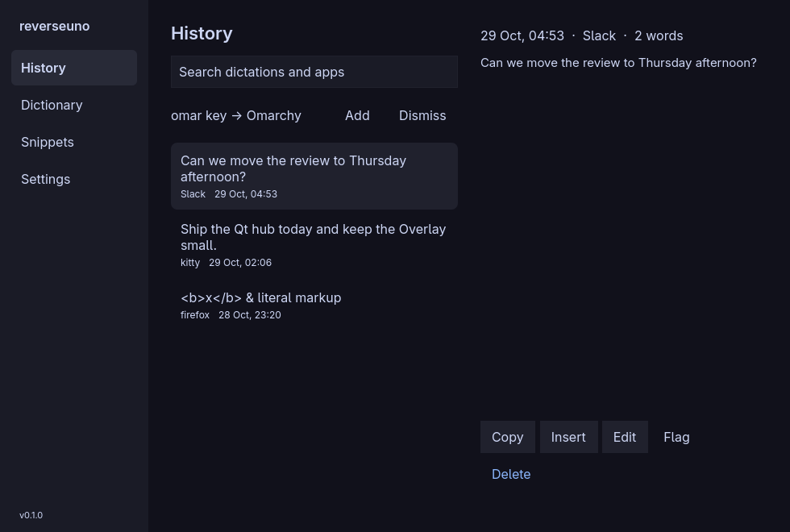
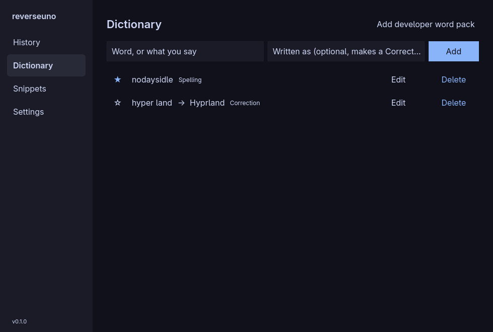
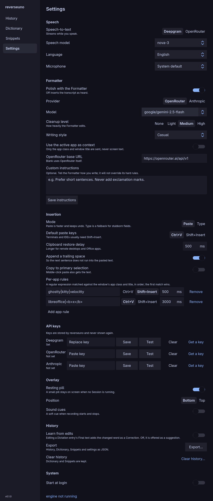
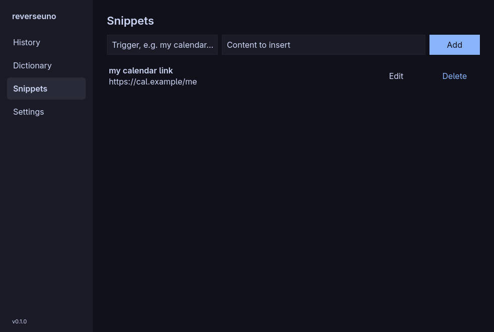

<div align="center">
  
  <h1>reverseuno</h1>
  <p><strong>Push-to-talk dictation for Omarchy / Hyprland.</strong></p>
  <p>Hold Right Super → speak → release. The polished text lands at your cursor.</p>

  <p>
    
    
    
    
    
    
    
    
  </p>
</div>

<table>
  <tr>
    <td width="62%" align="center"></td>
    <td width="38%" align="center"><br><br></td>
  </tr>
</table>

Linux only, shaped around Omarchy, Hyprland and an Apple Magic Keyboard (Right Cmd
is `Super_R`). A windowless Electron engine does the work; native Qt Quick windows (the
Hub, the Overlay and a tray icon) follow the Omarchy theme. Cloud speech-to-text, cloud
formatting, everything else local.

## The journey

One loop:

```text
Hold Right Super
  → speak
  → release
  → transcribe (Deepgram Nova-3 streaming, or an OpenRouter model)
  → polish (OpenRouter or Anthropic) + dictionary spellings
  → paste into the window you started in
```

| Stage | What happens |
|---|---|
| **Hold** | The Overlay appears with a live waveform and “Listening”. The focused window is remembered. |
| **Speak** | 16 kHz mono audio streams to Deepgram (or is buffered for OpenRouter). |
| **Release** | “Transcribing”, then “Polishing” with your cleanup level, writing style and dictionary. |
| **Paste** | Focus returns to the original window if it moved, then `Ctrl+V` or `Shift+Insert` per app. Your clipboard is restored. |
| **Done** | A short “Pasted”, then the Overlay hides. |

The Overlay is a layer-shell surface that never takes keyboard focus, so it cannot
steal the paste. Clicking the pill or `Super+Delete` cancels. If the original window
is gone, the text is left on your clipboard instead of landing somewhere else.

## What’s on screen

| Surface | Role |
|---|---|
| **Overlay** | A small pill: waveform and one state word (Listening, Transcribing, Polishing, Pasted, or the error). Optional Resting pill when idle. |
| **Hub → History** | Search your dictation entries; open one to read, edit, copy, insert, flag or delete it. Learned-edit suggestions sit on top. |
| **Hub → Dictionary** | Spellings and corrections. A spelling keeps its exact form, so `fastfetch` stays lowercase. **Add developer words** loads ~170 terms. |
| **Hub → Snippets** | Say a trigger, get the full text. |
| **Hub → Settings** | Speech provider, model, language and microphone; Formatter provider, model, cleanup level, writing style and custom instructions; insertion and per-app rules; API keys with a test button; Overlay; history export and clear; start at login. |
| **Tray** | State, start/stop, open the Hub, quit. |

No dashboard and no stats. Both windows follow the active **Omarchy theme** and
recolour live when it changes, even while the engine is down.

<table>
  <tr>
    <td width="50%" align="center"></td>
    <td width="50%" align="center"></td>
  </tr>
</table>

## Engines / models

BYOK. No keys ship with the app.

| Engine | Role | Network |
|---|---|---|
| **Deepgram Nova-3** | Default speech-to-text. WebSocket streaming with interim results, dictionary keyterms, whole-clip batch fallback. | Audio to Deepgram while you speak |
| **OpenRouter STT** | Alternative speech-to-text: any model from OpenRouter's transcription catalogue (default `openai/gpt-4o-mini-transcribe`). No live preview. | Audio to OpenRouter on release |
| **OpenRouter formatter** | Default cleanup and style. Hard timeout; falls back to the transcript as heard. | Transcript text to OpenRouter |
| **Anthropic formatter** | Alternative cleanup and style, straight to the Claude API (default `claude-haiku-5-5`, low effort). Same timeout and fallback. | Transcript text to Anthropic |

Pick the speech provider, the Formatter provider and their models in Hub → Settings;
the OpenRouter model fields suggest from OpenRouter's live lists. Keys are
read from Settings, then `DEEPGRAM_API_KEY` / `OPENROUTER_API_KEY` /
`ANTHROPIC_API_KEY`, then `~/.config/whisper-bar/config.env`.

For accented English, set Language to **English** rather than Multilingual: the
recogniser then never guesses another language.

## Stack

| Layer | Technology |
|---|---|
| Engine | Electron 44 (windowless main process + hidden capture window), electron-vite |
| Windows | Qt 6 Quick, C++17, `qmake6`; Overlay via `layer-shell-qt`; tray via `Qt.labs.platform` |
| Audio | `getUserMedia` + `AudioWorklet`, 640-sample (40 ms) frames |
| Speech-to-text | Deepgram WebSocket / REST, OpenRouter `/audio/transcriptions` |
| Formatting | OpenRouter chat completions, or the Anthropic Messages API (`@anthropic-ai/sdk`) |
| Insertion | `wl-copy` / `wl-paste`, `wtype`, `hyprctl` refocus |
| Hotkeys | Hyprland binds → `reverseuno` CLI → local HTTP control server |
| Engine ↔ windows | Same control server: `/rpc/<method>` calls and an `/events` server-sent-events stream |
| Storage | JSON in `~/.config/reverseuno/`; keys via `safeStorage` |

## Install

### Arch package

```bash
git clone https://github.com/nodaysidle/reverseuno.git
cd reverseuno/packaging
makepkg -si                                   # builds the engine and qt/, runs both test suites
python3 /usr/lib/reverseuno/scripts/install-hyprland.py   # Right Super binds + window rules
```

The package installs the engine to `/usr/lib/reverseuno` (run by Arch's `electron44`),
the Qt app to `/usr/lib/reverseuno/qt/reverseuno-ui` (linked as `/usr/bin/reverseuno-ui`),
the CLI as `/usr/bin/reverseuno`, and a **reverseuno** launcher entry that starts the
engine, which brings up the Qt app. The Hyprland script is per user, so the package
does not run it.

### From a checkout

Requires Arch / Omarchy with Hyprland, Node 22+, Qt 6 (`qt6-base`, `qt6-declarative`,
`qt6-wayland`, `layer-shell-qt`), `wtype`, `wl-clipboard` and `jq`.

```bash
git clone https://github.com/nodaysidle/reverseuno.git
cd reverseuno
npm install
npm run build
bash scripts/install-local.sh
```

`install-local.sh`:

- builds `qt/` (`qmake6 && make`); the engine starts `qt/reverseuno-ui` from the
  checkout itself, so nothing goes on `PATH`;
- symlinks `bin/reverseuno` to `~/.local/bin/reverseuno`;
- writes `~/.local/share/applications/reverseuno.desktop` and adds **Apps → reverseuno**
  to the Omarchy menu;
- backs up `~/.config/hypr/bindings.lua` and writes a managed block (rerunning updates
  it in place, including blocks older versions wrote):

```lua
o.bind("Super_R", "reverseuno hold", "~/.local/bin/reverseuno start")
o.bind("Super_R", "reverseuno release", "~/.local/bin/reverseuno stop", { release = true })
o.bind("SUPER + Super_R", "reverseuno release (super held)", "~/.local/bin/reverseuno stop", { release = true })
o.bind("SUPER + Delete", "reverseuno cancel", "~/.local/bin/reverseuno cancel")
o.window({ class = "^reverseuno$", title = "^reverseuno$" }, { float = true, center = true, size = { 980, 660 } })
hl.layer_rule({ match = { namespace = "^reverseuno-overlay$" }, no_anim = true, animation = "none" })
```

- comments out an old WhisperBar `Super_R` bind and reloads Hyprland.

The release is bound twice because Hyprland can still count Super as held while
`Super_R` is released; a duplicate stop is ignored. The real file uses absolute paths.
The Hub's Wayland app id is `reverseuno`; the Overlay's layer namespace is
`reverseuno-overlay`.

Then add your keys in Hub → Settings → API keys, hold **Right Super**, speak, and
release. For development with hot reload: `npm run dev` (the engine still starts
`qt/reverseuno-ui`; `REVERSEUNO_UI=<path>` picks another build, `REVERSEUNO_NO_UI=1`
runs without windows).

## Shortcuts

| Action | Default |
|---|---|
| Hold to dictate | `Right Super` (Right Cmd on a Magic Keyboard) |
| Cancel | `Super + Delete` |
| Cancel from the mouse | Click the Overlay pill |
| Start / stop from the mouse | Tray → start/stop (toggles, then pastes) |

## CLI

```bash
reverseuno start          # press
reverseuno stop           # release → transcribe → format → paste
reverseuno toggle
reverseuno cancel
reverseuno state
reverseuno show settings    # open the Hub: history (default), dictionary, snippets, settings
reverseuno paste "text"   # insert text at the focused cursor
reverseuno lang cycle
reverseuno quit
```

The CLI and the Qt app talk to `127.0.0.1:47100` (or the next free port) with a
per-run bearer token in `~/.config/reverseuno/control.json` (mode 0600); requests that
carry an `Origin` header are refused, so web pages cannot reach it. `show` starts the
Qt app first if it is not running. Each call is logged to
`~/.config/reverseuno/logs/app.log`.

## Testing

```bash
npm test                              # 114 engine tests (vitest)
npm run typecheck
(cd qt && make check)                 # 5 Qt suites, 32 tests, offscreen
npm run test:e2e                      # fake mic → STT → format → target window, with a focus steal
E2E_STT=openrouter npm run test:e2e   # the same run through OpenRouter transcription
```

The E2E harness feeds a known WAV through Chromium's fake microphone, steals focus to
a decoy window mid-dictation, and checks that the text lands in the original window,
the decoy stays empty, the clipboard is restored and history is written. The Qt tests
run on the offscreen platform and never put a window on the desktop. Real-key
push-to-talk with a physical mic is verified by hand.

## Architecture

```text
Right Super (Hyprland bind)
        │
        ▼
reverseuno CLI ──HTTP──▶ Electron main (DictationEngine, no windows) ◀──HTTP /rpc + /events──▶ reverseuno-ui (Qt)
                              │                                                  Hub, Overlay, tray
        ┌─────────────────────┼────────────────────────┐
        ▼                     ▼                        ▼
  capture renderer      Deepgram WS / OpenRouter  Formatter (OpenRouter or Anthropic)
  (hidden window)       interim + final           cleanup + style + dictionary
  AudioWorklet 16 kHz   batch fallback            timeout + fallback to the transcript
        │
        ▼
  refocus target → clipboard + wtype → restore clipboard
        │
        ▼
  history, dictionary, snippets (JSON)
```

The engine starts the Qt app and restarts it if it crashes (up to five times a
minute). It looks for `REVERSEUNO_UI`, then `<app>/qt/reverseuno-ui`, then
`reverseuno-ui` on `PATH`. Nothing in the push-to-talk path depends on the Qt app.

| Path | Responsibility |
|---|---|
| `src/main/dictation.ts` | State machine, streaming, fallback, formatting, insertion, history |
| `src/main/stt/` | Deepgram (WebSocket + batch) and OpenRouter clients |
| `src/main/format.ts` | Formatter prompt and the OpenRouter and Anthropic calls |
| `src/main/paste.ts` | Hyprland window lookup and refocus, clipboard snapshot/restore, `wtype` rules |
| `src/main/theme.ts` | Reads and watches the active Omarchy theme |
| `src/main/index.ts` | Capture window, control server, Overlay placement, autostart |
| `src/main/control.ts`, `api.ts` | Control server: CLI endpoints, `/rpc` table, `/events` stream |
| `src/main/supervisor.ts` | Finds, starts and restarts the Qt app |
| `src/renderer/` | Hidden capture renderer |
| `src/shared/` | Types, defaults, text cleanup, developer vocabulary, stats, WAV |
| `qt/` | `reverseuno-ui`: Hub, Overlay, tray, theme watcher, engine client, QtTests |
| `packaging/` | `PKGBUILD` and the launcher entry |
| `scripts/install-hyprland.py` | Idempotent Hyprland bind block, Hub window rule, Overlay layer rule |

## Known gaps

- **Hyprland only.** No X11, GNOME or KDE shortcut path; the Overlay needs a
  layer-shell compositor.
- No start/stop sound cues yet in the Qt Overlay (the `overlay.sounds` setting is kept).
- **Cloud only** by design: no offline Whisper.
- No paste verification (Linux would need AT-SPI). A failed paste is recorded in
  history but not retried.
- No focused-field context; only the app class and window title reach the formatter.
- A local `PKGBUILD` only: no AUR package, auto-update or signed releases yet.
- `safeStorage` falls back to a plainly marked value on systems without a keyring.

## Privacy

- Audio is streamed to Deepgram (or sent once to OpenRouter on release), held in
  memory for that request only, and never written to disk.
- The transcript goes to the chosen formatter (OpenRouter or Anthropic) when
  formatting is on; app class and window title can be sent as context (turn it off
  in Hub → Settings).
- History, dictionary, snippets and settings stay in `~/.config/reverseuno/`.

No accounts, no analytics, no telemetry.

## License

MIT. See [`LICENSE`](LICENSE).
